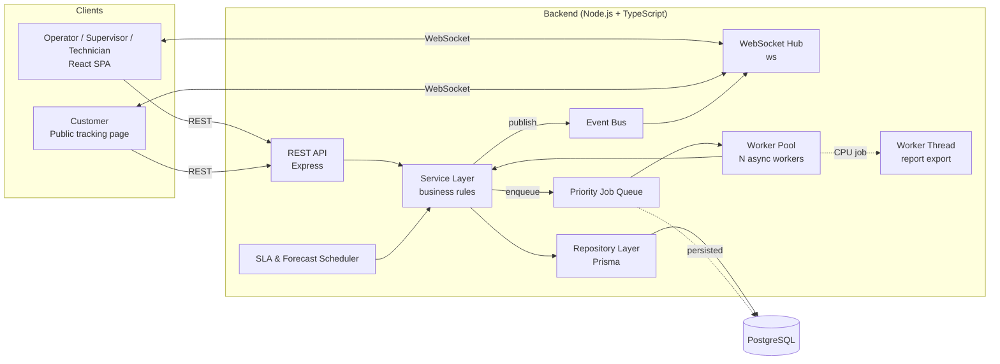
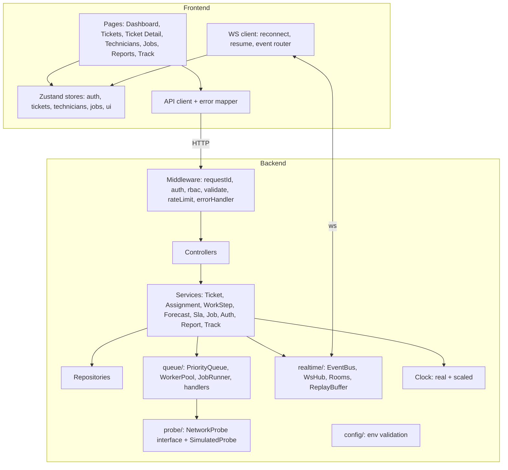
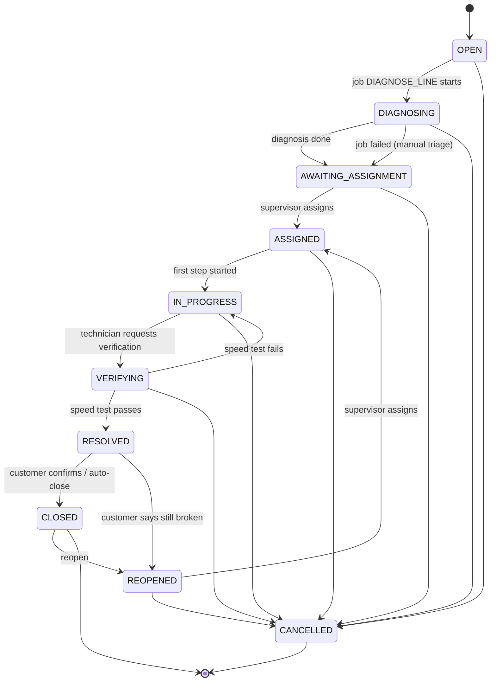
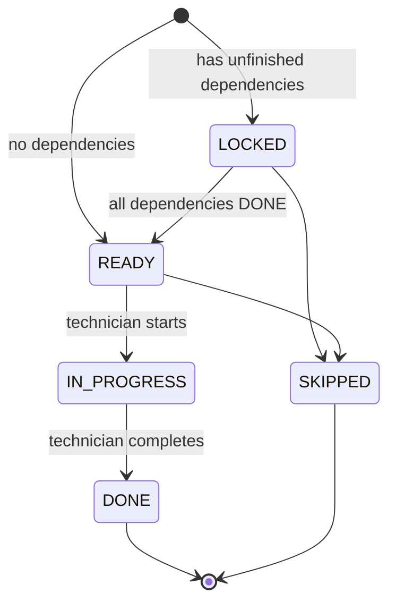
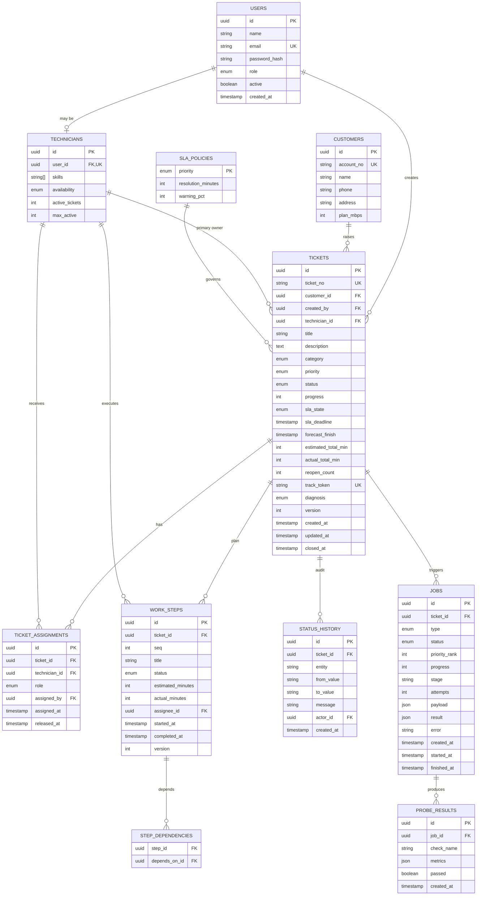
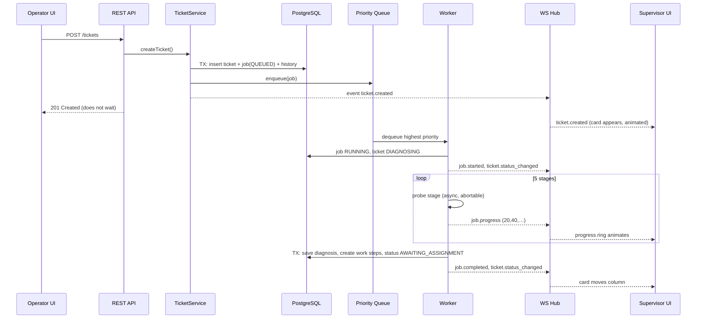
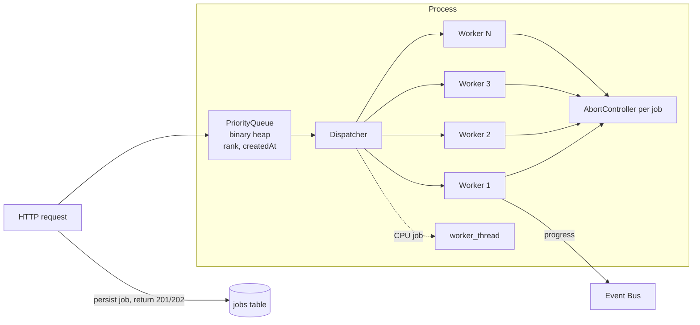
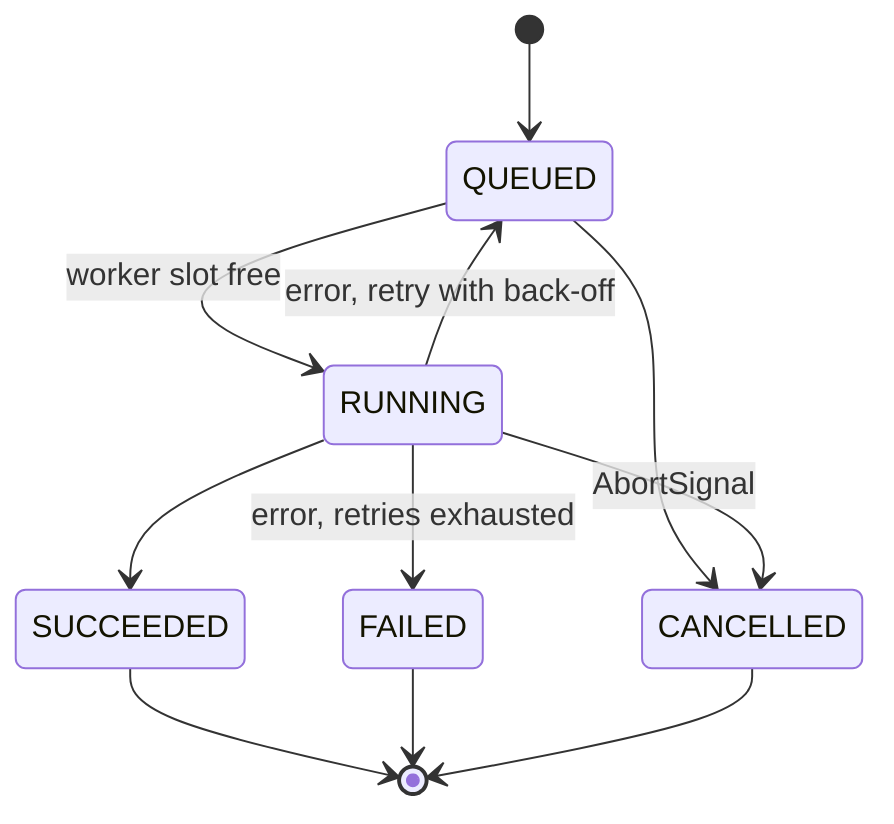

# Ticko: System Design

> Version 1.0 · Step 2 of the build. Follows `01-system-analysis.md`.

---

## 1. High-Level Architecture



**Request flow in one sentence:** the client calls REST to *do* something; the service validates the rules, writes to PostgreSQL in a transaction, publishes a domain event; the Event Bus fans it out through the WebSocket hub to every interested screen. Anything slow is turned into a job and executed by the worker pool.

---

## 2. Component Diagram



### Layer responsibilities

| Layer | Allowed to | Not allowed to |
|---|---|---|
| Controller | Parse request, call one service method, shape response | Contain business rules, touch DB |
| Service | Business rules, transactions, publish events, enqueue jobs | Know about HTTP (`req`/`res`) |
| Repository | Prisma queries | Business decisions |
| Queue/Worker | Execute job handlers, report progress | Write HTTP responses |
| Realtime | Authenticate sockets, route events | Contain business rules |

---

## 3. Technology Stack and Justification

| Layer | Choice | Justification |
|---|---|---|
| Runtime | **Node.js 20 + TypeScript** | Event loop suits many I/O-bound jobs + sockets; strict types reduce bugs |
| HTTP | **Express** | Mature, minimal, easy to layer |
| Realtime | **`ws`** (native WebSocket) | Protocol is explicit and explainable (no hidden Socket.IO polling fallback) |
| DB | **PostgreSQL 16** | Transactions, row locks, partial indexes, `SKIP LOCKED`, enums |
| ORM | **Prisma** | Typed queries, migrations, seed; raw SQL available for atomic updates |
| Validation | **Zod** | One schema → runtime validation + static types (shared with the frontend) |
| Auth | **JWT (HS256) + bcrypt** | Stateless; role claim for RBAC |
| Logging | **pino** | Fast structured JSON logs |
| Concurrency | Async worker pool + `AbortController` + `worker_threads` | I/O jobs on event loop; CPU job off-loop in a real thread |
| Frontend | **React 18 + Vite + TypeScript** | Fast dev loop, component model |
| State | **Zustand** | Tiny, no boilerplate, selectors keep re-renders minimal |
| Styling | **Tailwind CSS** | Responsive utilities, design tokens |
| Animation | **Framer Motion** | Layout animations for Kanban moves, spring physics, `useReducedMotion` |
| Charts | **Recharts** | Small, React-native charts |
| Tests | **Vitest + Supertest** (+ Testing Library) | One runner for both sides |
| DevOps | **Docker Compose + GitHub Actions** | One-command run + CI |

---

## 4. Project Structure (monorepo)

```
ticko/
├─ docs/                      # analysis, design, screenshots
├─ backend/
│  ├─ prisma/                 # schema.prisma, migrations, seed.ts
│  └─ src/
│     ├─ config/              # env.ts (Zod-validated), constants
│     ├─ controllers/
│     ├─ services/
│     ├─ repositories/
│     ├─ domain/              # state machines, forecast math, types (pure, unit-testable)
│     ├─ queue/               # PriorityQueue, WorkerPool, JobRunner, handlers/
│     ├─ probe/               # NetworkProbe interface, SimulatedProbe
│     ├─ realtime/            # EventBus, WsHub, Rooms, ReplayBuffer
│     ├─ middleware/
│     ├─ schemas/             # Zod request schemas
│     ├─ workers/             # worker_threads scripts (report)
│     ├─ utils/               # Clock, errors, logger
│     └─ app.ts / server.ts
├─ frontend/
│  └─ src/
│     ├─ api/  ws/  store/  hooks/
│     ├─ components/          # KanbanBoard, TicketCard, SlaRing, StepGantt, TechnicianCard, JobProgress ...
│     ├─ pages/
│     └─ styles/
├─ docker-compose.yml
├─ .github/workflows/ci.yml
└─ README.md
```

---

## 5. State Machines

### 5.1 Ticket


Illegal transitions → **422 `INVALID_TRANSITION`**. The transition table lives in `domain/ticketStateMachine.ts` and is unit-tested.

### 5.2 Work step


`OVERRUN` is **not a status**; it is a derived flag (`elapsed > estimated`), with levels `1.0×`, `1.5×`, `2.0×`. This keeps the workflow state clean while still showing delay.

---

## 6. Database Design

### 6.1 ERD



### 6.2 Enums
`Role`: OPERATOR, SUPERVISOR, TECHNICIAN, ADMIN
`Priority`: LOW, MEDIUM, HIGH, CRITICAL
`TicketStatus`: OPEN, DIAGNOSING, AWAITING_ASSIGNMENT, ASSIGNED, IN_PROGRESS, VERIFYING, RESOLVED, CLOSED, REOPENED, CANCELLED
`Category`: SLOW_SPEED, NO_CONNECTION, ROUTER_ISSUE, NEW_CONNECTION, BILLING_LINK, OTHER
`StepStatus`: LOCKED, READY, IN_PROGRESS, DONE, SKIPPED
`SlaState`: ON_TRACK, AT_RISK, WARNING, BREACHED
`JobType`: DIAGNOSE_LINE, VERIFY_SPEED, EXPORT_REPORT
`JobStatus`: QUEUED, RUNNING, SUCCEEDED, FAILED, CANCELLED
`Availability`: AVAILABLE, BUSY, OFF_DUTY

### 6.3 Constraints and indexes

| Item | Definition | Why |
|---|---|---|
| FK + `ON DELETE RESTRICT` on audit tables | Prevents history loss | Accountability |
| `CHECK (active_tickets >= 0 AND active_tickets <= max_active)` | DB-level capacity guard | Last line of defence for BR-02 |
| `CHECK (progress BETWEEN 0 AND 100)` | Valid percent | Integrity |
| `CHECK (estimated_minutes > 0)` | Valid plan | Integrity |
| `UNIQUE (ticket_id, seq)` on steps | Stable ordering | |
| `UNIQUE (ticket_id) WHERE role='PRIMARY' AND released_at IS NULL` (partial) | **One active primary owner per ticket** | BR-01/BR-03 |
| `UNIQUE (ticket_id, type) WHERE status IN ('QUEUED','RUNNING')` (partial) | No duplicate running job of same type | Idempotency |
| `INDEX tickets(status)`, `(priority, created_at)`, `(sla_deadline) WHERE status NOT IN ('CLOSED','CANCELLED')`, `(technician_id)` | Kanban, queue, SLA scan | Performance |
| `GIN` / `pg_trgm` index on `title, description, customer name` | Fast `ILIKE` search | FR-10 |
| `INDEX jobs(status, priority_rank, created_at)` | Queue recovery order | |
| `INDEX status_history(ticket_id, created_at)` | Timeline | |

### 6.4 Concurrency-safe SQL (key statements)

**Atomic capacity reservation** (inside the assignment transaction):
```sql
UPDATE technicians
SET active_tickets = active_tickets + 1
WHERE id = $1 AND availability <> 'OFF_DUTY' AND active_tickets < max_active
RETURNING id;           -- 0 rows → 409 TECHNICIAN_AT_CAPACITY
```
**Optimistic ticket update:**
```sql
UPDATE tickets SET technician_id=$2, status='ASSIGNED', version=version+1, updated_at=now()
WHERE id=$1 AND version=$3 AND technician_id IS NULL;   -- 0 rows → 409 VERSION_CONFLICT
```
If either statement affects 0 rows the whole transaction rolls back, so capacity is never leaked.

---

## 7. REST API Design

Base path `/api` · JSON · `Authorization: Bearer <jwt>` · IDs are UUIDs.
Error envelope: `{ "error": { "code": "VERSION_CONFLICT", "message": "…", "details": [...], "requestId": "…" } }`

| Status | Meaning |
|---|---|
| 200/201/202 | OK / Created / Accepted (job queued) |
| 400 | Validation failed (Zod) |
| 401 / 403 | Not authenticated / role not allowed |
| 404 | Not found |
| 409 | `VERSION_CONFLICT`, `TECHNICIAN_AT_CAPACITY`, `ALREADY_ASSIGNED` |
| 422 | `INVALID_TRANSITION`, `STEP_LOCKED` |
| 429 | Rate-limited |

### 7.1 Auth & users
| Method | Path | Roles | Purpose |
|---|---|---|---|
| POST | `/auth/login` | public | Email + password → JWT |
| GET | `/auth/me` | any | Current user |
| GET/POST/PATCH | `/users` | admin | Manage users |

### 7.2 Tickets
| Method | Path | Roles | Purpose |
|---|---|---|---|
| POST | `/tickets` | operator, supervisor, admin | Create + enqueue `DIAGNOSE_LINE` → **201** |
| GET | `/tickets` | staff | List. Query: `status, priority, category, technicianId, slaState, q, from, to, sort, page, limit` |
| GET | `/tickets/:id` | staff / own technician | Detail incl. steps, jobs, forecast |
| PATCH | `/tickets/:id` | operator+ | Edit (requires `version`) |
| GET | `/tickets/:id/timeline` | staff | Audit trail |
| GET | `/tickets/:id/suggestions` | supervisor | Ranked technician suggestions |
| POST | `/tickets/:id/assign` | supervisor | `{technicianId, version}` |
| POST | `/tickets/:id/helpers` | supervisor | Add helper |
| POST | `/tickets/:id/request-verification` | assigned technician | Enqueue `VERIFY_SPEED` → **202** |
| POST | `/tickets/:id/confirm` | operator+ | Record customer confirmation → CLOSED |
| POST | `/tickets/:id/reopen` | operator+ | `{reason}` |
| POST | `/tickets/:id/cancel` | operator (own) / supervisor | `{reason}` |

### 7.3 Work steps
| Method | Path | Roles | Purpose |
|---|---|---|---|
| GET | `/tickets/:id/steps` | staff | Steps + dependencies + derived overrun level |
| POST | `/tickets/:id/steps` | supervisor | Add step `{title, estimatedMinutes, dependsOn[]}` |
| PATCH | `/steps/:id` | supervisor | Edit estimate/dependencies/assignee |
| POST | `/steps/:id/start` | assigned technician | 422 `STEP_LOCKED` if deps not done |
| POST | `/steps/:id/complete` | assigned technician | Sets `actual_minutes`, unlocks dependants |
| POST | `/steps/:id/skip` | supervisor | |

### 7.4 Technicians, jobs, metrics, reports
| Method | Path | Roles | Purpose |
|---|---|---|---|
| GET | `/technicians` | staff | With load and current tickets |
| PATCH | `/technicians/:id/availability` | supervisor / self | |
| GET | `/jobs` | supervisor | Queue + running + recent |
| POST | `/jobs/:id/cancel` | supervisor | Cooperative cancel |
| POST | `/jobs/:id/retry` | supervisor | |
| GET | `/metrics` | staff | Queue length, workers busy, jobs/min, breaches, open tickets |
| GET | `/reports/summary` | supervisor | Avg resolution, SLA compliance %, estimate accuracy |
| POST | `/reports/export` | supervisor | → **202** `{jobId}` (worker thread) |
| GET | `/reports/export/:jobId` | supervisor | Download CSV when ready |
| GET/PUT | `/sla-policies` | admin | |

### 7.5 Public (customer)
| Method | Path | Purpose |
|---|---|---|
| GET | `/public/track/:token` | Limited, non-sensitive ticket view |
| POST | `/public/track/:token/confirm` | "Fixed" → CLOSED |
| POST | `/public/track/:token/report-issue` | "Still broken" → REOPENED |

### 7.6 Operations
`GET /healthz` (liveness) · `GET /readyz` (DB + queue ready)

---

## 8. WebSocket Design

### 8.1 Connection and protocol

- Endpoint: `ws://host/ws`. Staff authenticate with the first message `{type:"auth", token}` (token never in URL logs). Customers connect with `{type:"auth", trackToken}`.
- Unauthenticated sockets are closed after 5 s.
- Heartbeat: server pings every 25 s; no pong in 10 s → terminate.
- Every server message uses one envelope:

```json
{ "seq": 1842, "type": "ticket.status_changed", "ts": "2026-10-26T10:15:00.123Z",
  "room": "staff", "payload": { "ticketId": "…", "from": "ASSIGNED", "to": "IN_PROGRESS", "version": 7 } }
```

### 8.2 Rooms (audience routing)

| Room | Members | Receives |
|---|---|---|
| `staff` | Operators, supervisors, admins | All ticket, job, technician, SLA, metrics events |
| `tech:{technicianId}` | That technician | Own assignments, own step unlocks |
| `ticket:{id}` | Anyone viewing that ticket | Fine-grained job progress and step events |
| `track:{ticketId}` | Customer tracking page | Sanitised status/progress only |

### 8.3 Event catalogue (server → client)

| Event | Payload (summary) | Room |
|---|---|---|
| `ticket.created` | ticket summary | staff |
| `ticket.updated` | changed fields, version | staff, ticket |
| `ticket.status_changed` | from, to, actor | staff, ticket, track |
| `ticket.assigned` | technician, ticket | staff, tech, ticket |
| `ticket.cancelled` / `ticket.reopened` / `ticket.closed` | reason | staff, ticket, track |
| `step.updated` | step, derived overrun level | ticket, tech |
| `step.unlocked` | step id | ticket, tech |
| `step.overrun` | step, level (1.0/1.5/2.0) | staff, ticket |
| `forecast.updated` | forecastFinish, estimatedTotal, actualTotal | staff, ticket, track |
| `job.queued` / `job.started` | job | staff |
| `job.progress` | jobId, progress, stage | staff, ticket, track |
| `job.completed` / `job.failed` / `job.cancelled` | result / error | staff, ticket |
| `sla.at_risk` / `sla.warning` / `sla.breached` | ticketId, deadline | staff, ticket |
| `technician.updated` | load, availability | staff |
| `metrics.updated` (throttled 1/s) | queue length, busy workers… | staff |
| `presence.updated` | online users | staff |
| `system.resync_required` | — | any |

### 8.4 Client → server
`auth` · `subscribe {room}` · `unsubscribe {room}` · `resume {lastSeq}` · `ping`

### 8.5 Sequence: create ticket → live diagnostics



### 8.6 Reconnect and resync
Hub keeps a ring buffer of the last 1,000 events. On reconnect the client sends `resume {lastSeq}`. If the gap is inside the buffer, missed events are replayed in order; otherwise the server sends `system.resync_required` and the client refetches via REST once. This prevents "stale dashboard" bugs without polling.

---

## 9. Concurrency Model

### 9.1 Overview



- **Why not block the request?** The API only *inserts* the job and enqueues it; the HTTP response is sent immediately. Workers run on the event loop and `await` I/O, so the server keeps serving requests while many jobs are in flight.
- **Pool size** `WORKER_CONCURRENCY` (default 3). Dispatcher picks the highest-priority ready job whenever a worker slot frees up.
- **Priority:** `CRITICAL=0, HIGH=1, MEDIUM=2, LOW=3`, then `createdAt` (FIFO). A critical ticket jumps ahead of queued low-priority jobs but does **not** preempt a running one.
- **Aging** (anti-starvation): a queued job's effective rank improves by 1 per 5 minutes waited.
- **Thread safety:** JavaScript handlers run single-threaded, so in-memory structures are race-free between `await` points. Cross-request races are handled in the **database** (transactions, conditional updates, version column). Each job handler is idempotent.

### 9.2 Job lifecycle


Retries: max 3, delay 2 s → 4 s → 8 s. After final failure the ticket falls back to manual triage and supervisors get a `job.failed` alert.

### 9.3 Cooperative cancellation
Every running job owns an `AbortController`. Handlers pass `signal` into every awaited step (`await sleep(ms, {signal})`, probe calls). `POST /tickets/:id/cancel` or `POST /jobs/:id/cancel` calls `controller.abort()`; the handler throws `AbortError` at the next checkpoint, the runner marks the job `CANCELLED`, releases resources, and publishes `job.cancelled`. A *queued* job is simply removed from the heap.

### 9.4 Crash recovery
Jobs are written to `jobs` **before** being enqueued. On boot: `SELECT … WHERE status IN ('QUEUED','RUNNING')` → `RUNNING` rows are reset to `QUEUED` (`attempts+1`) and pushed into the heap. Handlers are idempotent (they upsert results), so re-running is safe.

### 9.5 Worker thread for CPU work
`EXPORT_REPORT` aggregates thousands of rows and builds CSV. It runs in a `worker_threads` Worker so the event loop (HTTP + WebSocket) is never starved. Result is streamed back via `postMessage`, stored, and announced with `job.completed`.

### 9.6 Concurrency-safe business operations

| Scenario | Protection |
|---|---|
| Two supervisors assign the same ticket | Transaction + `UPDATE … WHERE version=$v AND technician_id IS NULL` + partial unique index → one 200, one 409 |
| Technician capacity race | Atomic `UPDATE … WHERE active_tickets < max_active` |
| Two clients edit one ticket | `version` check → 409 |
| Same step started twice | `UPDATE steps SET status='IN_PROGRESS' WHERE id=$1 AND status='READY'` |
| Duplicate verify requests | Partial unique index on active jobs per (ticket, type) |
| Cancel while worker is writing | Worker re-checks `ticket.status` inside its final transaction; aborts if `CANCELLED` |

### 9.7 SLA and overrun scheduler
A single **tick loop every 1 s** (scaled by the Clock) does cheap, indexed work:
1. Scan open steps `IN_PROGRESS` → compute `elapsed/estimate`; emit `step.overrun` when crossing 1.0×/1.5×/2.0× (stored `last_overrun_level` prevents repeats).
2. Scan open tickets near deadline (`sla_deadline` index) → update `sla_state` and emit once per transition.
3. Recompute `forecast_finish` only for tickets with changed steps or running overruns.
4. Emit throttled `metrics.updated`.

### 9.8 Forecast algorithm (the "20 → 50 minutes" logic)

For each ticket, treat steps as a DAG. For every unfinished step *s*:

```
remaining(s) =
   DONE:                 0
   IN_PROGRESS & within estimate : estimate − elapsed
   IN_PROGRESS & overrun : max(0.25 × estimate, 5 min)      # optimistic but never zero
   READY/LOCKED:         estimate

finish(s) = max(finish(dep) for dep in dependencies, now) + remaining(s)
forecast_finish = max(finish(s) over all steps)
```
- **Sequential** steps add up; **independent** steps overlap (max, not sum).
- `sla_state = AT_RISK` when `forecast_finish > sla_deadline` while the ticket is still before the warning threshold.
- `estimated_total = Σ estimated_minutes`; `actual_total = Σ actual_minutes (+ running elapsed)`. Both are always displayed.

### 9.9 Clock abstraction
`Clock.now()` returns real time or **scaled** time (`DEMO_TIME_SCALE=60` → 1 real second = 1 simulated minute). All SLA, step timers and probes use it, so the whole behaviour can be demoed in a few minutes and unit-tested with a fake clock.

---

## 10. Security Design

| Concern | Control |
|---|---|
| Authentication | bcrypt (cost 12), JWT 8 h, secret from env |
| Authorization | `requireRole(...)` middleware; technicians restricted to own tickets (ownership check in service) |
| Input | Zod on body, query, params; unknown keys stripped |
| Abuse | `express-rate-limit` (login stricter), WS message size cap, max sockets per user |
| Transport/headers | `helmet`, strict CORS allow-list |
| SQL injection | Prisma parameterisation; raw SQL only with bound params |
| Customer link | 128-bit random token, only non-sensitive fields exposed, revocable |
| Secrets | `.env` never committed; `.env.example` provided |
| Errors | Internal stack traces never returned to clients |

---

## 11. Validation, Errors, Configuration

- **Validation:** Zod schemas in `schemas/`, applied by `validate()` middleware; the same schemas generate frontend form validation.
- **Errors:** custom `AppError(code, status, message, details)` hierarchy; one central handler maps `ZodError`, Prisma errors (`P2002` → 409, `P2025` → 404), `AppError`, and unknown errors (500, logged).
- **Config:** `config/env.ts` parses `process.env` with Zod and fails fast on startup. Key variables: `PORT`, `DATABASE_URL`, `JWT_SECRET`, `WORKER_CONCURRENCY`, `MAX_ACTIVE_TICKETS`, `DEMO_TIME_SCALE`, `VERIFY_PASS_THRESHOLD`, `AUTO_CLOSE_HOURS`, `CORS_ORIGIN`, `LOG_LEVEL`.

---

## 12. Frontend Design

### 12.1 Pages

| Page | Roles | Contents |
|---|---|---|
| Login | all | Form + inline validation |
| **Command Center** (dashboard) | supervisor/admin | Live Kanban, KPI strip, technician rail, job feed, SLA alerts |
| Tickets | staff | Table + advanced filters + debounced search + "New ticket" drawer |
| Ticket Detail | staff / tech | Header, SLA ring, job progress, **Step Gantt (estimate vs actual)**, timeline, assignment panel |
| My Work | technician | Own tickets, big Start/Complete buttons, step checklist |
| Technicians | supervisor | Cards with load meter and current tickets |
| Jobs | supervisor | Queue, running workers, history, cancel/retry |
| Reports | supervisor | KPIs, charts, CSV export |
| Track (public) | customer | Live progress, simple timeline, Confirm / Still broken |

### 12.2 State management (Zustand)
Stores: `authStore`, `ticketStore` (normalised by id + column index), `technicianStore`, `jobStore`, `metricsStore`, `uiStore` (filters, drawer, toasts, connection status). A single **WS event router** maps each event type to a store action, so components never talk to the socket directly. REST is used for commands and initial load; WebSocket keeps state fresh (no polling).

### 12.3 Design language: "Mission Control"
- **Dark NOC theme** by default (light theme toggle), glass panels, subtle grid background.
- Colour tokens: `ok #22c55e`, `info #38bdf8`, `warn #f59e0b`, `danger #ef4444`, `critical #f43f5e`, neutral slate scale. Colour is never the only signal (icons + labels too).
- Typography: Inter for UI, JetBrains Mono for ticket numbers/timers.

### 12.4 Animation plan (Framer Motion, all respect `prefers-reduced-motion`)

| Element | Animation |
|---|---|
| Kanban card moves between columns | `layoutId` shared-layout spring; card glides, destination column glows briefly |
| New ticket | Slides in with scale + highlight pulse |
| Job progress | Circular ring fills smoothly; stage label cross-fades |
| SLA ring | Countdown arc; colour morphs green → amber → red; **pulses** when at-risk, **shakes once** on breach |
| Step Gantt | Estimated bar (ghost) behind actual bar; actual grows live in real time; overrun segment turns amber then red with hatch pattern |
| Locked → Ready step | Padlock icon unlocks with a small bounce |
| Technician load meter | Segments fill with a spring; "FULL" badge when at capacity |
| Connection badge | Green heartbeat pulse; amber "reconnecting…" shimmer |
| Toasts | Slide from the edge, auto-dismiss with progress line |
| Number tickers | KPI numbers count smoothly |
| Empty / loading | Skeleton shimmer, friendly empty-state illustrations |

### 12.5 Responsiveness
Mobile-first breakpoints (`sm 640`, `md 768`, `lg 1024`, `xl 1280`). Kanban becomes horizontally snap-scrollable on mobile; tables collapse into cards; drawers become bottom sheets.

### 12.6 Form validation
React Hook Form + the shared Zod schema → inline messages on blur, disabled submit until valid, server-side errors mapped to fields (400 `details`), phone/address format checks, 409 conflicts shown as a friendly "Someone else updated this ticket. Reload?" dialog.

---

## 13. Quality, DevOps, Observability

| Area | Plan |
|---|---|
| **Unit tests** | Priority queue ordering/aging, state machines, forecast math, step dependency unlocking, SLA transitions (fake clock) |
| **Integration tests** | Supertest + test DB: auth/RBAC, ticket CRUD/filter, **concurrent assign (Promise.all) → exactly one success**, version conflict, capacity limit |
| **Concurrency tests** | 20 tickets at once → ≤ N running, API still answers in < 100 ms; cancellation aborts a running job; restart recovery |
| **WS tests** | Auth required, room isolation, resume/replay |
| **Frontend tests** | Store reducers, form validation, key components |
| **CI** | GitHub Actions: install → lint → typecheck → test (Postgres service) → build → Docker build |
| **Docker** | `docker compose up` → postgres, backend (migrate + seed), frontend (nginx) |
| **Logging** | pino JSON, `requestId`, job/ticket IDs on every line |
| **Metrics** | `/api/metrics` + live `metrics.updated` |
| **Git** | Conventional commits, one feature per commit, `main` always green |

---

## 14. Build Plan (commit order)

| # | Step | Commit |
|---|---|---|
| 1 | Analysis | `docs: add system analysis` |
| 2 | Design | `docs: add system design` |
| 3 | Scaffold, Docker Compose, env config | `chore: scaffold monorepo` |
| 4 | Prisma schema, migration, constraints, seed | `feat(db): schema, constraints, seed` |
| 5 | Auth, RBAC, validation, error handler, logger | `feat(auth): jwt and roles` |
| 6 | Tickets CRUD, search/filter, history | `feat(api): tickets` |
| 7 | Technicians + atomic assignment + suggestions | `feat(assign): concurrency-safe assignment` |
| 8 | Work steps, dependencies, estimate vs actual | `feat(steps): dependencies and overrun` |
| 9 | Priority queue, worker pool, diagnose/verify jobs | `feat(queue): worker pool` |
| 10 | Cancellation, retry, crash recovery, worker thread | `feat(queue): cancel and recovery` |
| 11 | EventBus, WebSocket hub, rooms, resume | `feat(realtime): websocket hub` |
| 12 | SLA scheduler, forecast, metrics | `feat(sla): forecast and escalation` |
| 13 | Frontend shell, auth, API client, stores, WS client | `feat(ui): app shell` |
| 14 | Tickets page, create form, filters | `feat(ui): tickets` |
| 15 | Command Center: Kanban, SLA rings, technician rail | `feat(ui): live dashboard` |
| 16 | Ticket detail: Step Gantt, timeline, jobs; My Work | `feat(ui): ticket detail` |
| 17 | Customer tracking page, reports | `feat(ui): tracking and reports` |
| 18 | Tests | `test: unit, api, concurrency` |
| 19 | CI + polish | `ci: github actions` |
| 20 | README + screenshots | `docs: readme` |

---

## 15. Implementation notes (deviations from the plan above)

| Topic | Plan | As built | Why |
|---|---|---|---|
| ORM | Prisma 5 | **Prisma 6.19 + `@prisma/adapter-pg`** (engine-less client) | no native query-engine binary, simpler containers |
| Time scale | scaled clock produced timestamps | **only durations are scaled**; stored timestamps are real | restarts / scale changes cannot corrupt SLA or step data |
| Locking | version column | `SELECT … FOR UPDATE` row lock **and** version check; derived fields (progress, forecast, SLA) do **not** bump `version` | serialises writers; users editing a form get no spurious conflicts |
| SLA window | `created_at` | extra column `tickets.sla_started_at` (migration 2) | a reopened ticket gets a fresh SLA window |
| `VERIFYING` transition | done by the job | done synchronously by `request-verification`, the job only evaluates | instant UI feedback, no duplicate requests |
| Technician capacity | held until `CLOSED` | released at `RESOLVED` | the technician is free once the fix is verified |
| Report worker | TypeScript worker | plain-JS `workers/reportWorker.js` copied to `dist` | `worker_threads` need no loader in production |
| Customer view | not in plan | public tracking page + WebSocket `track:` room | closes the loop with the customer |
| Field simulator | not in plan | `npm run demo:traffic` | repeatable live demo |


---

## 16. Iteration 2: accounts, categories, reports, step ordering

**Data model changes (migration `20261028000000_users_categories`)**
* `users.token_version INT`: embedded in the JWT (`tv`). Resetting a password increments it, so every older token is rejected. `authenticate` and the WebSocket `auth` call `resolveUser()`: verify JWT, then compare with the cached server-side session (`active`, `tokenVersion`, `role`), cached ≤ 5 s and invalidated whenever an admin edits the user.
* `categories(code PK, name UNIQUE, description, plan_template Diagnosis, default_priority, active, builtin, sort_order)` replaces the `Category` enum; `tickets.category` is now a FK to `categories.code`. Custom categories use `plan_template` to choose the diagnosis/work-plan; built-ins keep their specific simulation logic.

**New endpoints**: `POST /auth/change-password`, `GET/POST/PATCH/DELETE /categories`, `PATCH /users/:id` (e-mail, password, skills, capacity, active), `GET /reports/technicians/day`, `GET /reports/technicians/:id/day`, `GET /reports/throughput`. `POST /tickets/:id/steps` accepts `insertAfter`.

**Insert into the chain** (`insertStepAfterTx`): inside the ticket-locked transaction, shift `seq` of later steps by +1 (two-phase update to respect `UNIQUE(ticket_id, seq)`), create the new step depending on step N, then re-point every not-yet-started dependant of N to the new step.

**Technician day report** (`technicianDay`): steps where `assignee = technician`, `started_at < to` and (`completed_at IS NULL` or `completed_at >= from`); merges overlapping intervals to compute active minutes and gaps between blocks (idle); joins `status_history` for the completion note; plus assignments and resolved tickets in the range. Authorisation: a technician may only request their own id.

**Command Center**: KPI strip → *Field team · live* (running step + elapsed/estimate bar per technician, derived from `step.updated` events) + *Needs attention* (SLA breached/warning/at-risk, unassigned, overrunning steps) → live Kanban → throughput chart (counters arrive over WebSocket; chart refetches only when they change), worker pool, activity feed.
